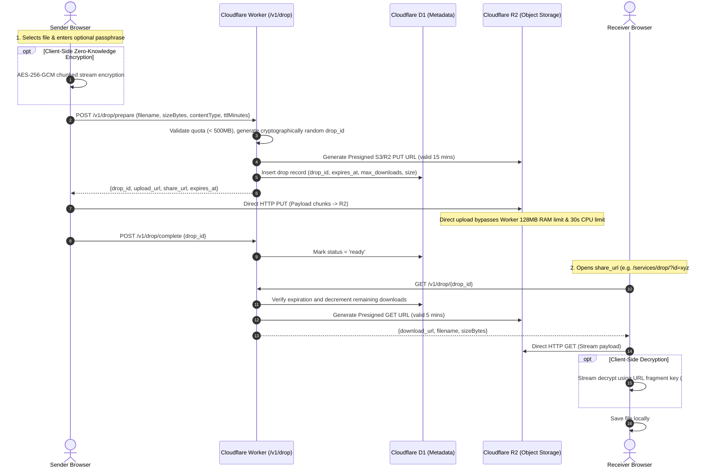

# Temporary Large-File Drop: Architectural Specification & Blocker Analysis

## 1. Executive Summary & Status

The **Temporary Large-File Drop** tool is designed to allow frictionless, peer-to-peer or ephemeral file sharing for payloads exceeding email attachment limits (e.g., 50 MB to 1 GB), featuring time-bounded auto-expiry and optional client-side encryption.

**Current Deployment Status: BLOCKED (Documented Blocker)**

As instructed, this service is **not** deployed as a fake UI or mock generator on the live site. We strictly adhere to our project honesty principles:

- No simulated upload bars that don't actually persist or transfer data.
- No fake share links that fail when opened on a different network or device.
- No unauthenticated or third-party ad-laden external hosting embeds.

---

## 2. The Technical Requirement & GitHub Pages Limitations

GitHub Pages serves strictly static assets (HTML, CSS, JS, pre-rendered WASM/images). It does not provide:

1. Persistent backend storage or writable disk partitions.
2. HTTP `POST` / `PUT` endpoints capable of ingesting binary payloads.
3. Automated object lifecycle management (TTL-based expiration/deletion).

Consequently, any cross-device file transfer requires a dedicated object-storage backend with authenticated presigned URLs and lifecycle rules.

---

## 3. Current Infrastructure Blocker

### Account & Environment Details

- **Cloudflare Account ID**: `7f7a2c4f3bd6de5bf8fda3b750edb850`
- **Authenticated Account**: `ahzahid1995@gmail.com`
- **Database Status**: Cloudflare D1 (`quizora-production`) is active and operational.
- **Worker Status**: Cloudflare Worker (`quizora-api`) is live and operational.

### R2 Storage Status

When attempting to provision the required R2 bucket for large file staging:

```bash
wrangler r2 bucket create lab-file-drop
```

Cloudflare returned error code `10042`:

```
⛅️ wrangler 4.149.0
───────────────────
Creating bucket 'lab-file-drop'...
[ERROR] Please enable R2 through the Cloudflare Dashboard. [code: 10042]
```

**R2 is not currently enabled** on this Cloudflare account. Enabling R2 in the Cloudflare Dashboard requires credit card verification (even though Cloudflare provides a generous free tier of 10 GB/month storage and zero egress fees). In accordance with instructions never to provision paid or billing-sensitive external resources autonomously, R2 bucket creation was halted.

---

## 4. Proposed Production Architecture (Upon Enabling R2)

When Anwar chooses to enable R2 in the Cloudflare Dashboard, the following architecture should be deployed:



### Key Architectural Strengths

1. **Zero Worker Memory Overhead**:
   Files stream directly between the user's browser and Cloudflare R2 using AWS S3-compatible Presigned URLs. The Cloudflare Worker only handles small JSON requests (URL issuance and metadata), avoiding the 128 MB RAM execution ceiling and sub-second CPU limits.

2. **Zero-Knowledge Privacy (E2EE)**:
   The file can optionally be encrypted client-side using Web Crypto `AES-256-GCM` before uploading. The encryption key is placed in the URL hash fragment (`#key`). Because browsers never send URL hash fragments to the server in HTTP requests, Cloudflare and network intermediaries never possess the key.

3. **Guaranteed Auto-Expiry & Cost Protection**:
   - **R2 Lifecycle Policy**: Configured to auto-delete objects older than 24 hours.
   - **Worker Cron Trigger**: Scheduled batch sweeps D1 database records every 10 minutes to remove expired entries.
   - **Burn-on-Download**: Configurable single-use download links that immediately trigger object deletion once fetched.

4. **Zero Egress Bandwidth Fees**:
   Unlike AWS S3 or Google Cloud Storage, Cloudflare R2 charges **$0.00** for outbound data transfer (egress), making it optimal for free public tools.

---

## 5. Enablement Steps for the Site Owner

To activate the Temporary Large-File Drop service when desired:

1. **Enable Cloudflare R2**:
   - Log in to the [Cloudflare Dashboard](https://dash.cloudflare.com/).
   - In the left sidebar, navigate to **R2 Object Storage**.
   - Click **Enable R2** and confirm account setup.

2. **Provision the Bucket**:

   ```bash
   wrangler r2 bucket create lab-file-drop
   ```

3. **Configure Lifecycle Rule**:
   In the R2 bucket settings, set an object lifecycle rule:
   - Action: Delete objects
   - Age: 1 day (24 hours)

4. **Bind Bucket to Worker**:
   Add the R2 bucket binding to `worker/wrangler.toml`:

   ```toml
   [[r2_buckets]]
   binding = "DROP_BUCKET"
   bucket_name = "lab-file-drop"
   ```

5. **Deploy Service Route**:
   The frontend component and API routes are architected to attach seamlessly to `/services/drop/` without modifying other services.
